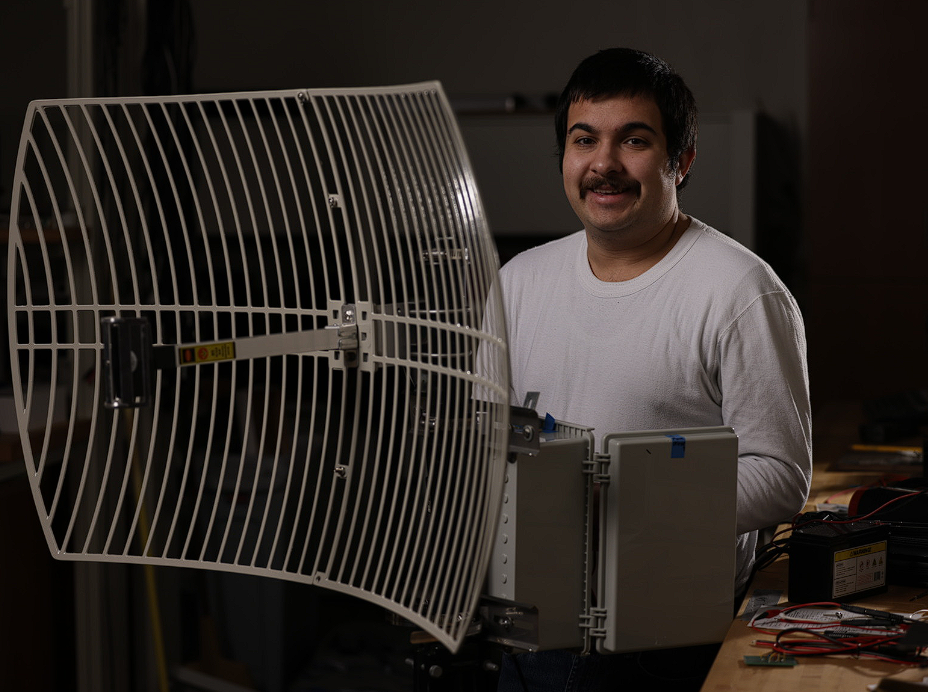

<!--
This is the template for student pages. To add yourself to the website, start with the instructions found in docs/directory/current_students.md.

The profile picture here uses the same as on the current students page, but if you'd like a larger or higher resolution one for your page then you can add another photo. Just make sure it isn't too large, ideally no larger than 10mb.
-->

# James Subieta

{ width=350px }

---

- **Email**: jamessubieta@gmail.com
- **Linkedin**: [www.linkedin.com/in/james-subieta](https://www.linkedin.com/in/james-subieta/)
- **Github**: https://github.com/jamessubieta

## About

James Subieta received his B.S. degree in electrical engineering in 2025 from Brigham Young University. In the past, he worked in Dr. Mazzeo’s electromagnetics lab focusing on long range sensing and Bluetooth communication. James is currently pursuing a M.S. degree in electrical engineering at BYU. He works in the BYU Magicc lab under Dr. Beard, with specialty and interest in GNC, radar/ vision systems, tracking/ optimization algorithms, data association, simultaneous localization and mapping, and state estimation. 

## Research

James is currently working on expanding multiple target tracking capabilities on radar systems. This is a project funded through the center of autonomous air mobility [(CAAMS)](https://www.caams.center/) 

The previous project James worked on was on GPS denied navigation assisting in utilizing LTE signals of opportunity to derive navigation solution corrections for drones. 

- [Project Name Here](../../research/projects/{project_name_here}.md)
- [GPS Denied Navigation](../../research/projects/gps_denied_navigation.md)

## Papers

- [Air-to-Ground Radar Multi-Target-Tracking using Factor Graphs and Recursive Random Sample Consensus]({https://www.ion.org/plans/abstracts.cfm?paperID=17298})
- [Long-Range Bluetooth Smart Stake System for Soil Sensing]({https://doi.org/10.1109/IETC57902.2023.10152045})

## {Other Projects of Interest}
<!-- 
You can add other sections here if you'd like, but put interesting content on your project page if it is related to a project, creating a page for your project if necessary. In other words, only personal projects would end up here. -->

These are some news reports on previous projects James has worked on. James's capstone had the team utilize already present radio hardware on drones to pass FAA remote ID requirements. The smart stake work also got reported on. For student outreach, James designed and built a remote control dirigible to demonstrate the world of electrical engineering to incoming students. Stay tuned for future projects that could wind up here! 

- [Remote ID software update](https://ece.byu.edu/department-news/no-hardware-no-problem-remote-id-for-older-drones)
- [Smart Stakes News](https://news.byu.edu/intellect/a-farmers-field-of-dreams-byu-built-smart-technology-measures-will-adjust-watering-automatically)
- [The Remote Controlled Dirigible](https://app.notion.com/p/Dirigible-70c48b14c589466cba33fdbab277a9f6?source=copy_link)