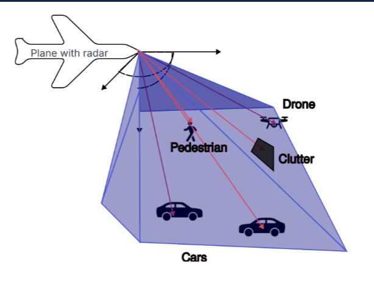
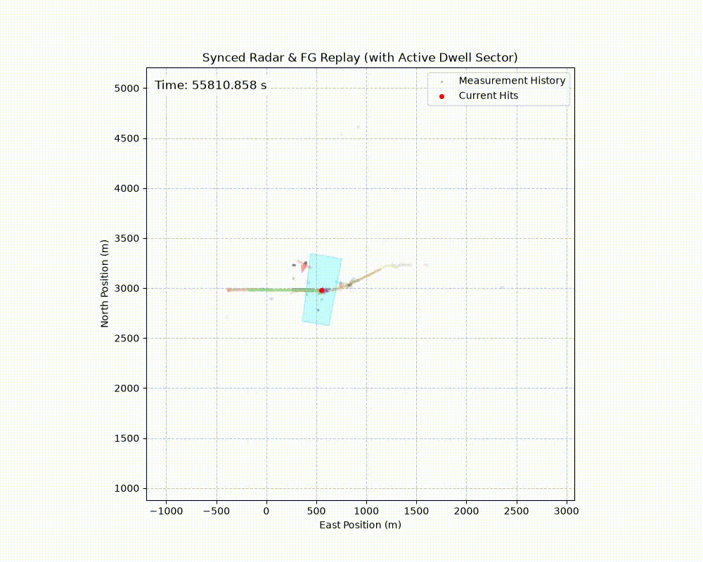
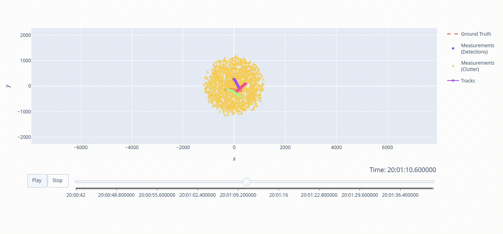

<!--
This is the template for project pages. To add an additional project to the website, start with the instructions found in docs/research/current_projects.md.
-->

# Air-to-Ground Radar Multi-Target-Tracking using Factor Graphs and Recursive Random Sample Consensus

<!-- Write a mid-length summary here. We want this to give a good overview of the project's work and focus, but not be so in-depth that it starts to sound like a publication. Many website visitors are just going to skim this page, so we want the most important information easily presented. As such, we ask that EACH PROJECT HAS AT LEAST ONE VISUAL (more is better) describing their project.

Include any pictures, videos, slides, posters, etc. you want. Small files can be included directly in the `docs/research/projects/assets/{your project name here}` folder (less than 10mb in size), but anything larger should be put elsewhere (YouTube, Box) and embedded externally. Also, MAKE SURE YOU ARE ALLOWED TO SHARE ANY FILES PUBLICLY BEFORE POSTING THEM HERE.

This template is intended to act as a starting point, but feel free to make modifications as you need to suit the needs of your project. Just try to make it look cohesive with the rest of the current projects. -->
This project focuses on applying Recursive Random Sample Consensus (R-RANSAC) to multiple target tracking (MTT) in air to ground radar systems. While there exist several MTT solutions in the radar context, air-to-ground radar systems present a difficult challenge. A scanning surveillance radar deals with high amounts of randomly spaced clutter, multiple different target types, sidelobe interference, asynchronous measurement updates, sensor blackout and signal attenuation from different environments. R-RANSAC is another possible solution to MTT in air to ground environments with encouraging results compared to state-of-the-art multiple target tracking algorithms, particularly using track continuity and clutter suppression metrics. A demonstration of multitarget air-to-ground radar environment is shown below:

R-RANSAC was initially developed for vision-based tracking on UAV platforms, in particular, the applied random sampling method proved capable in the high noise, high clutter characteristics typically present with vision sensors in an MTT setting. There have been two important modifications to the R-RANSAC framework. First, the system was applied to the tracking problem with an air-to-ground radar. R-RANSAC's lie-group integrated probability data association method proved exceptionally capable in clutter suppression and mitigating spurious tracks compared to a standard MHT-JPDA-EKF based tracker. Second, a factor-graph moving-horizon optimization approach was applied to the lie group-based data association method denoted as R-RANSAC-FG. Accuracy and track estimation are similar in both R-RANSAC's EKF and the R-RANSAC-FG implementation and provide a modest improvement to general track accuracy and estimation of the JPDA-EKF. However, the factor graph approach presents some key advantages for future models and solutions. Live data was gathered from IMSAR’s NSP family of radar sensors mounted on a civilian aircraft flying over a moderately busy road through a rural hayfield in Utah. The following animation demonstrates tracking results for different automobile targets primarily on the roadway but traveling through high radar-clutter regions. The algorithm effectively handles sensor blackout and sidelobe interference.

Simulation results demonstrate R-RANSAC FG approaches through the usage of the Stone Soup radar simulator. 

## Sponsors

Project funded through the Center for Autonomous Air Mobility and Sensing. 
Radar data acquired from IMSAR's NSP family of light weight radars. Additional support and assistance provided by IMSAR.

- [Center for Autonomous Air Mobility & Sensing](https://caams.center/)
- [IMSAR]({https://www.imsar.com/})

## Personnel

Current Students and Faculty of the Magicc lab associated with the project:
- [James Subieta](../../directory/students/james_subieta.md)
- [Dr. Beard](../../directory/faculty.md)

<!-- ## Significant Results -->

<!-- Include bullet items of significant outcomes of the project. If you list a new contribution in a paper or thesis, include a description of that contribution here. -->
<!-- - Demonstration of R-RANSAC applied to air-to-ground radars in multiple environments. -->

<!-- ## Videos

Notice the `embed` link here. You'll want to copy the part of your YouTube link between `.../watch?v=` and `&...` into the link segment right after `.../embed/`. The original link for this video was `https://www.youtube.com/watch?v=JMWN0OI-7pA&list=PLYgEzAHuTvsB92GTxdTiCdQNb5b1RMUl8&index=4`.

 -->

## Papers, Theses, and Presentations

- [IEEE/ION PLANS 2027]({https://www.ion.org/plans/abstracts.cfm?paperID=17298})

<!-- - [Paper Name Here]({DOI line here})
- [Presentation Name Here]({Link to powerpoint presentation}) -->

